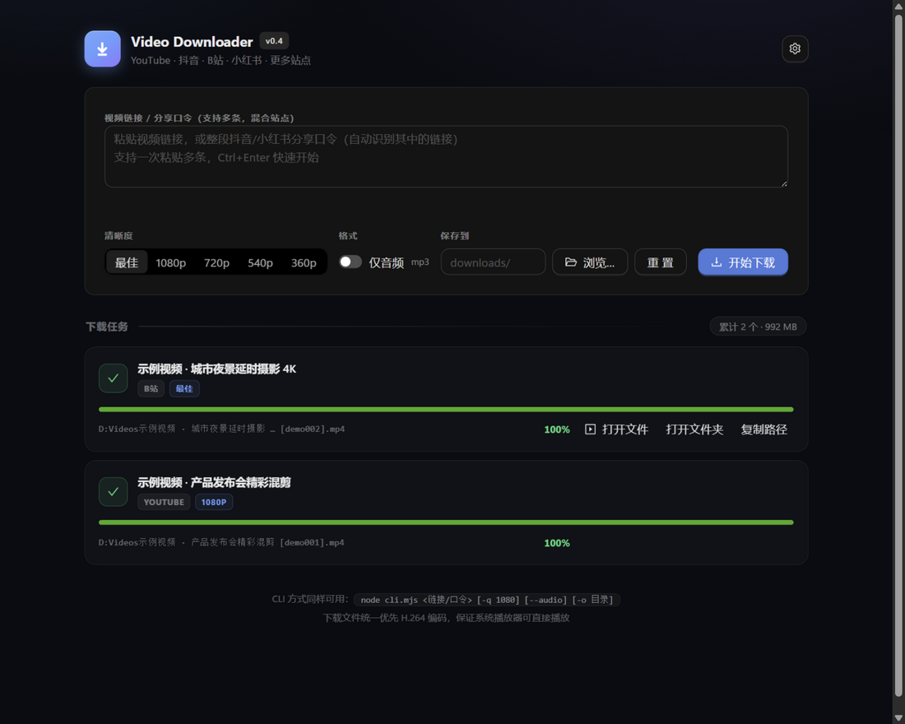

<div align="center">


# Video Downloader

**A polished video download tool — YouTube · Douyin · Bilibili · Xiaohongshu · 1000+ sites**

[](https://github.com/SillyShalong/video-downloader/releases)
[](https://www.electronjs.org/)
[](https://react.dev/)
[](https://ant.design/)
[](LICENSE)
[](#-automated-tests)

**Desktop app + CLI + Android app** · Quality selection · Real-time speed · Pause/Cancel · Download history · H.264 output · Bilingual UI

[Download](#-install) · [Quick Start](#-quick-start) · [Android](#-android-app) · [Development](#-development) · [中文文档](README.zh-CN.md)

</div>

---



## ✨ Features

| | | |
|---|---|---|
| 🌍 **1000+ sites** | YouTube (Shorts/playlists), Douyin, Bilibili, Xiaohongshu + all yt-dlp supported sites | Paste URL or full **share text** — auto-detected |
| 🎞 **Quality selection** | Best / 1080p / 720p / 540p / 360p | Bilibili SESSDATA login for higher quality |
| 📋 **Multi-source picker** | Playlists/channels auto-detected | Check the videos you want, download only those |
| 🗂 **Download history** | Full metadata persisted (URL, path, size) | Compact list + detail drawer, delete individual records |
| 🔎 **Stream source** | The address the video actually comes from: host of each video/audio stream + the IPs this machine resolves it to | Shown above the log in the details, to tell which server a 403 or a stall is coming from (desktop) |
| 🧭 **Proxy or direct?** | Every download is marked "via proxy" or "direct" as soon as it starts; HLS and domestic sites that bypass the configured proxy are flagged in a warning colour | Task row (when a proxy is configured) and the details (desktop) |
| 🛡 **H.264 guaranteed** | All sites lock H.264+AAC | Windows default player works, no black screen |
| 🌐 **Proxy support** | HTTP/SOCKS5 with one-click test | Douyin/Xiaohongshu auto-bypass (domestic) |
| 🔁 **Stable downloads** | Auto-retry transient errors (403/timeout); when segment URLs expire, fresh ones are fetched and the download resumes — no half-finished files | Manual pause / cancel / resume; everything downloaded so far is kept |
| ⚡ **Parallel downloads** | 3 tasks at once by default (desktop: `maxParallel` in `config.json`, 1–8; Android: ⚙ Settings, 1–5) | Extra tasks queue up automatically |
| 📱 **Android app** | **Works on its own** — YouTube, Bilibili, HLS streaming sites | Pick any folder, pause/resume, no PC needed |
| 🌏 **Bilingual** | 中文 / English UI toggle in settings | All labels, buttons, messages translated |
| 🖥 **Dual interface** | Electron desktop (native dialogs) | CLI for scripting (`node cli.mjs`) |

## 📥 Install

**End users (recommended)**: Download from [Releases](https://github.com/SillyShalong/video-downloader/releases):

- `VideoDownloader-Setup-x.y.z-x64.exe` — Windows installer (choose directory, desktop shortcut)
- `VideoDownloader-Portable-x.y.z-x64.exe` — Windows portable (no install needed)
- `VideoDownloader-Android-vX.Y.Z.apk` — Android app (standalone)

No Node.js/Python required — yt-dlp, ffmpeg, and deno are all bundled (desktop).

**From source**:

```bash
git clone https://github.com/SillyShalong/video-downloader.git
cd video-downloader
npm install
npm run setup        # Download yt-dlp / ffmpeg / deno
npm run build:web    # Build frontend
npm start            # Launch desktop app
```

## 🚀 Quick Start

### GUI

1. Paste a video URL or share text (multiple links supported)
2. Select quality → Click **Download**
3. For playlists: check the videos you want in the selection modal
4. Real-time progress with speed/ETA; click any row for full details. 3 tasks download at once by default, the rest queue.

On the desktop each task downloads into its own `.vd-tmp-<task id>` subfolder of the target folder and the finished file is moved in afterwards (an existing file with the same name is kept; the new one becomes "name (1)"). After a pause or a failure the unfinished parts stay in that subfolder, so resume / retry continues from where it stopped; cancelling or deleting the task removes it.

### CLI

```bash
node cli.mjs "https://www.youtube.com/watch?v=xxxx"          # YouTube
node cli.mjs "douyin share text"                              # Douyin
node cli.mjs "https://www.bilibili.com/video/BV..." -q 1080  # Bilibili 1080p
node cli.mjs --audio "https://youtu.be/xxxx" -o D:/Music      # Audio only (mp3)
node cli.mjs "https://youtu.be/xxxx" -p http://127.0.0.1:7890 # Via proxy
```

## 📱 Android App

The Android app runs **entirely on the phone** — it does not need the desktop app, a PC on the LAN, or any external program:

| On Android | How it works |
|---|---|
| **YouTube** | Stream URLs resolved on-device (via the [NewPipeExtractor](https://github.com/TeamNewPipe/NewPipeExtractor) library); video + audio streams are downloaded and muxed into one MP4 on the phone. H.264 up to 1080p; audio-only saves as `.m4a` |
| **Bilibili** | Standalone engine (no yt-dlp). Multi-part videos are detected and selectable |
| **HLS streaming sites** | Paste a `.m3u8` link directly, or add the site's domain in ⚙ Settings and paste the page link. The app opens the page itself and finds the playlist: from the player's requests, a `<video>` element, or addresses written in the page's script / JSON data (escaped or not). When a page lists one playlist per quality, the one matching the chosen quality is used. Encrypted (AES-128) and fMP4 streams are supported |
| **Cloudflare checks** | If a page shows a human-verification challenge, it opens in an in-app window — complete the check there and the download continues automatically |
| **Save to any folder** | "Browse…" opens the system folder picker — it starts inside the current folder, so "Use this folder" is one tap away; files go to `Download/VideoDownloader` by default |
| **Control** | Pause / cancel / retry, all resuming from where they stopped; expired segment URLs (HTTP 403) are refreshed automatically; 3 tasks download at once by default (configurable); real-time speed, download history, proxy (HTTP / SOCKS5), bilingual UI |

- **Remote mode** (optional): Desktop runs `node gui.mjs --lan` → app ⚙ Settings → enter the server address. The app can then also control the desktop service over LAN.
- **Not available on Android**: Douyin and Xiaohongshu (use the desktop app), and yt-dlp's generic "other sites".
- Android refuses to let an app pick the root of `Download`, and reclaims folders that are completely empty. So when you open the folder picker before the default folder exists, the app creates `Download/VideoDownloader` with a tiny `VideoDownloader.txt` inside — the picker can then open straight into that folder instead of a disabled "Use this folder" button.

- **Upgrades install over the old version**: every released APK is signed with the same key (the key lives in the repository's GitHub Actions secrets, not in the repo). From v1.11.1 on, a new version installs straight over the old one and keeps settings and history. v1.11.0 and earlier were signed with a different key each time, so moving to v1.11.1 means uninstalling once.

The muxer is written for correctness first: B-frame reordering, AAC encoder delay and audio/video alignment are preserved so the downloaded file plays exactly like the source (verified frame-by-frame against ffmpeg — see [Automated Tests](#-automated-tests)).

**Build the APK yourself** (needs JDK 21 + Android SDK):

```bash
npm run android:apk     # → android/app/build/outputs/apk/debug/app-debug.apk
```

A local build is signed with the machine's own debug key and will not install over a released version. To sign with the release key, set the environment variables `VD_KEYSTORE_PATH`, `VD_KEYSTORE_PASSWORD` and `VD_KEY_ALIAS` (explained in `android/app/build.gradle`).

## 🔧 Platform Details

| Site | Desktop | Android |
|---|---|---|
| YouTube | yt-dlp + deno (JS challenges); proxy supported | On-device resolution + own MP4 muxer |
| Bilibili | yt-dlp; SESSDATA for 720p+ | Standalone engine; SESSDATA supported |
| Douyin | Custom (headless Edge in-page signing); **must use share links** | — |
| Xiaohongshu | Custom (headless Edge page data); **must use App share links** | — |
| HLS sites | Custom (headless Edge + m3u8 extraction; resumes when segment URLs expire); domains via `config.json` `hlsSites` | In-app page load + m3u8 extraction (resume supported too); domains via ⚙ Settings |
| Other sites | yt-dlp generic (1000+ sites); expiring segment URLs resume the same way | — |

## 🧪 Automated Tests

```bash
npm test                    # Desktop: build frontend + all tests (91; the 2 that need the internet are skipped by default)
npm run test:gui            # Desktop GUI regression (headless Edge drives the real page)
npm run test:hls            # Desktop HLS engine / generic downloader: resuming after segment URLs expire (local test source, no internet needed)
npm run test:network        # Desktop: enable external-network tests

npm run test:android        # Android: JVM unit tests (41) — needs JDK 21 + Android SDK
npm run test:android:media  # Android: muxer vs ffmpeg, frame by frame (on the PC, no device)
npm run test:android:e2e    # Android: real-GUI E2E on an emulator (adb taps/typing, ffmpeg verifies files); needs ANDROID_HOME or adb on PATH
npm run test:android:big    # Android: 4GiB big-file regression — needs an emulator with ≥ 11 GB free storage and adb root; see tests/android-big-file-check.mjs
```

- **Desktop (91)**: site detection, share-text parsing, download args (H.264 lock regression; quality caps also apply to sites that only offer muxed streams), stream source (yt-dlp output parsing, host → IP, proxy case), proxy-or-direct marker (fixed-direct sites stay direct with a proxy configured), proxy validation, explorer command line, download task pipeline (SSE → disk), retry/pause/cancel, parallel downloads (3 at once by default, the 4th queues), history persistence, multi-source selection, anti-flicker, modal close, remote-mode errors — and **resuming after segment URLs expire**: a local server rotates its token every few segments, and both the HLS engine and the yt-dlp path must finish the download, fetch each segment exactly once, and produce byte-identical output to an error-free run; an unreachable segment has to fail loudly instead of leaving a half-finished file, and cancelling kills the process immediately while keeping the resume point.
- **Android JVM (41)**: MP4 writer/reader round-trips (timestamps, keyframes, edit lists, B-frames, fragmented files whose sample table is not empty, a `traf` with several `trun`s, a fragment without `tfdt` continuing after the previous one), m3u8 parsing, MPEG-TS/PES construction, ADTS splitting, AES-128 decryption, URL/site detection, filename sanitizing, finalising a TS file larger than 2 GiB.
- **Android media check**: our muxer's output must match `ffmpeg -c copy` *frame by frame* (picture hash + presentation time + keyframe table), audio sample-exact, A/V start alignment, zero decode errors — on synthetic media (with B-frames), fragmented MP4, HLS fMP4, and with `--yt` real YouTube streams.
- **Android E2E (27 scenarios)**: on a real emulator UI — launch, Bilibili/YouTube/HLS downloads (files pulled and verified with ffmpeg), system folder picker (starts in the current folder, picking a folder, cancelling, invalid folder), multi-part selection, pause/resume, resume after the app is killed, cancel, detail drawer, settings, delete history, HLS download continuing from its resume point after segment URLs expire, retry after a mid-download HLS failure without re-downloading, a page whose per-quality playlists exist only as escaped JSON (the chosen quality has to be used), Bilibili pause/resume, YouTube audio-only, parallel downloads (3 at once by default, serial when set to 1, YouTube and HLS mixed).
- **Android big-file regression**: a 4 GiB HLS video (600 segments) — the last few segments are downloaded from a pre-seeded resume point, then the full "system TS extractor → mux → save to Downloads" path runs; the output is pulled to the PC (SHA-256 verified) and matches the ffmpeg reference on all 30,000 frames. The small-file cases never reach the "file larger than 2 GiB" code paths, so this runs separately.

## 🛠 Development

```
web/src/         React + AntD frontend (Vite, bilingual)
electron/        Electron main process (native dialogs, paths)
src/             Core engines (yt-dlp wrapper / Douyin / Xiaohongshu / HLS / task queue / SSE)
bin/             yt-dlp · ffmpeg · deno (npm run setup)
android/         Capacitor project: same UI + native Kotlin (local server, task engine, engines, MP4 muxer)
tests/           Desktop: node:test (unit / server / GUI). Android: JVM tests in android/app/src/test, media check, E2E
```

```bash
npm run dev       # Frontend hot-reload
npm run dist      # Package Windows installer + portable (release/)
npm test          # Full desktop test suite
```

## ❓ FAQ

**Video has audio but no picture?**
No. All downloads lock H.264 encoding (yt-dlp defaults to VP9/AV1 which Windows players can't decode). Non-H.264 sources are auto-transcoded.

**Bilibili limited to 480p?**
Guest access caps some videos. ⚙ Settings → paste SESSDATA (browser F12 → Cookie) to unlock.

**Download fails with 403?**
Usually proxy exit IP rotation. Built-in auto-retry (3 attempts); manual retry available on task row.

**Android: an HLS page does not start downloading?**
Some streaming sites gate playback behind a human-verification challenge. The app opens the page in a window — finish the check there (or press play if the player did not start). If YouTube itself is not reachable on your network, set a proxy in ⚙ Settings or use a system VPN.

## 📄 License

[GPL-3.0](LICENSE). The Android app links [NewPipeExtractor](https://github.com/TeamNewPipe/NewPipeExtractor) (GPL-3.0), so the project as a whole is distributed under the same license.

---

<div align="center">
⭐ If this helps you, consider giving it a Star!
</div>
