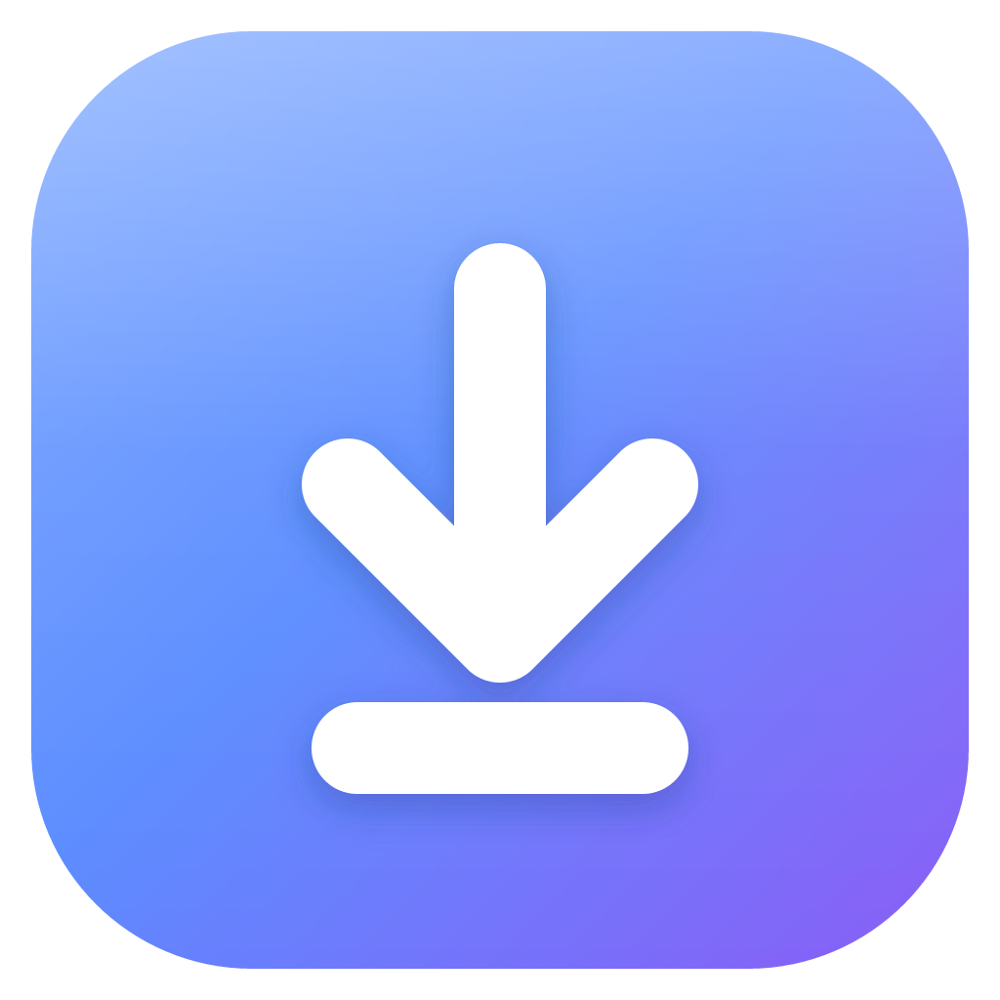
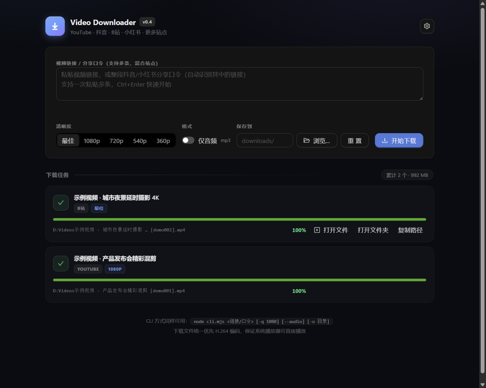

<div align="center">



# 🎬 Video Downloader

**一个界面精致的视频下载工具 —— YouTube · 抖音 · 哔哩哔哩 · 小红书 · 千余站点**

[](https://github.com/SillyShalong/video-downloader/releases)
[](https://www.electronjs.org/)
[](https://react.dev/)
[](https://ant.design/)
[](LICENSE)
[](#-自动化测试)

**桌面应用 + CLI + 安卓应用** · 清晰度自选 · 实时速度 · 暂停/终止 · 下载历史 · H.264 兼容 · 中英双语

[下载安装包](#-下载安装) · [快速上手](#-快速上手) · [安卓应用](#-安卓应用) · [开发指南](#-开发) · [English](README.md)

</div>

---



## ✨ 特性

| | | |
|---|---|---|
| 🌍 **千余站点** | YouTube（含 Shorts/播放列表）、抖音、哔哩哔哩、小红书 + yt-dlp 支持的全部站点 | 粘贴链接或**整段分享口令**，自动识别站点 |
| 🎞 **清晰度自选** | 最佳 / 1080p / 720p / 540p / 360p | B 站支持 SESSDATA 登录解锁高清晰度 |
| 📋 **多视频源选择** | 播放列表/合集/频道自动检测 | 勾选想下的视频，只下载选中的 |
| 🗂 **下载历史** | 元数据持久化（原始链接/目标路径/大小） | 紧凑列表 + 详情抽屉，可删除单条记录 |
| 🔎 **视频流来源** | 详情里显示真正在下的地址：视频 / 音频各自的域名 + 本机解析出的 IP | 排查 403、卡顿时知道连的是哪台服务器（桌面版） |
| 🧭 **走代理还是直连** | 每个下载一开始就标明数据是走设置里的代理，还是直连；HLS、国内站点绕过代理时用醒目颜色提示 | 任务行（设了代理时）和详情里都显示（桌面版） |
| 🛡 **兼容性优先** | 全站锁定 H.264 + AAC | Windows 自带播放器直接可放，不黑屏 |
| 🌐 **代理支持** | HTTP / SOCKS5，一键测试连通 | 抖音/小红书智能直连不走代理 |
| 🔁 **稳定下载** | 瞬时错误（403/超时）自动重试；分段地址过期时自动换新地址，从断点接着下，不会留下半截文件 | 手动暂停 / 终止 / 恢复，已下好的部分都保留 |
| ⚡ **多任务同时下载** | 默认 3 个任务同时下载（桌面版改 `config.json` 的 `maxParallel`，1–8；安卓在 ⚙ 设置里改，1–5） | 多出来的任务自动排队 |
| 📱 **安卓应用** | **可独立运行** —— YouTube、B站、HLS 流媒体站点 | 自选保存目录，暂停/恢复，不需要电脑 |
| 🌏 **中英双语** | ⚙ 设置中一键切换语言 | 所有按钮/提示/状态文案均已翻译 |
| 🖥 **双形态** | Electron 桌面应用（原生目录选择框） | CLI 命令行（脚本友好） |

## 📥 下载安装

**普通用户（推荐）**：到 [Releases](https://github.com/SillyShalong/video-downloader/releases) 下载最新版：

- `VideoDownloader-Setup-x.y.z-x64.exe` — Windows 安装包（可选安装目录、创建桌面快捷方式）
- `VideoDownloader-Portable-x.y.z-x64.exe` — Windows 便携版（免安装，双击即用）
- `VideoDownloader-Android-vX.Y.Z.apk` — 安卓应用（独立运行）

开箱即用，无需安装 Node.js / Python，yt-dlp、ffmpeg、deno 全部内置（桌面版）。

**从源码运行**：

```bash
git clone https://github.com/SillyShalong/video-downloader.git
cd video-downloader
npm install          # 安装依赖
npm run setup        # 下载 yt-dlp / ffmpeg / deno 到 bin/
npm run build:web    # 构建前端
npm start            # 启动桌面应用
```

## 🚀 快速上手

### GUI

1. 粘贴视频链接或整段分享口令（支持一次多条、混合站点）
2. 选择清晰度 → 点「开始下载」
3. 播放列表/合集会弹出**多视频源选择**（全选/全不选/按条勾选，显示时长）
4. 任务列表实时显示进度/速度，点击行查看详情；默认 3 个任务同时下载，其余排队

桌面版的每个任务先下到目标目录里的 `.vd-tmp-<任务 id>` 子目录，下完再把文件挪进目标目录（已有同名文件时另存为「名字 (1)」，不覆盖）。暂停、失败后没下完的部分留在这个子目录里，恢复 / 重试时从断点继续；终止或删除任务时一并清掉。

### CLI

```bash
node cli.mjs "https://www.youtube.com/watch?v=xxxx"          # YouTube
node cli.mjs "抖音分享口令整段直接粘贴"                        # 抖音
node cli.mjs "https://www.bilibili.com/video/BV..." -q 1080  # B站 1080p
node cli.mjs --audio "https://youtu.be/xxxx" -o D:/Music      # 仅音频转 mp3
node cli.mjs "https://youtu.be/xxxx" -p http://127.0.0.1:7890 # 走代理
```

## 📱 安卓应用

安卓应用**完全在手机上独立运行** —— 不依赖桌面端、局域网里的电脑或任何外部程序：

| 手机上能做什么 | 怎么实现的 |
|---|---|
| **YouTube** | 在手机上解析出视频流/音频流地址（借助 [NewPipeExtractor](https://github.com/TeamNewPipe/NewPipeExtractor) 库），两路下载后用自研封装器在本地合成一个 MP4。最高 1080p（H.264）；仅音频保存为 `.m4a` |
| **B站** | 独立引擎（不用 yt-dlp）。多 P 视频自动识别，可勾选 |
| **HLS 流媒体站点** | 直接粘贴 `.m3u8` 地址；或在 ⚙ 设置里添加站点域名后粘贴网页链接。应用内打开网页自己找播放列表：播放器发出的请求、`<video>` 的地址、以及写在页面脚本 / JSON 数据里的地址（转义过的写法也认）都找得到；页面上每个清晰度各给一个地址时，按所选清晰度挑。支持 AES-128 加密和 fMP4 分段 |
| **Cloudflare 人机验证** | 页面出现人机验证时，自动在应用内窗口里打开网页 —— 在里面点一下通过验证，下载自动继续 |
| **保存到任意目录** | 「浏览…」调起系统文件夹选择器，并直接停在当前目录里 —— 点一下「使用此文件夹」即可；默认保存到 `下载/VideoDownloader` |
| **任务控制** | 暂停 / 终止 / 重试，都从断点继续；分段地址过期（HTTP 403）时自动刷新播放列表接着下；默认 3 个任务同时下载（设置里可调）；实时速度、下载历史、代理（HTTP / SOCKS5）、中英双语 |

- **远程模式**（可选）：桌面端执行 `node gui.mjs --lan` → App ⚙ 设置 → 填服务器地址。之后也可以用它通过局域网操控桌面服务。
- **安卓上暂不支持**：抖音、小红书（请用桌面版），以及 yt-dlp 的「其他站点」。
- 系统不允许应用直接选「下载」根目录，空文件夹也会被回收。所以默认目录还不存在时点「浏览…」，App 会建出 `下载/VideoDownloader` 并在里面放一个很小的 `VideoDownloader.txt` —— 选择器才能直接停在这个目录里，而不是对着一个灰掉的「使用此文件夹」按钮。

封装器把正确性放在第一位：B 帧重排、AAC 编码预滚、音画对齐都原样保留，下载下来的文件播放效果与源一致（已用 ffmpeg 逐帧校验，见[自动化测试](#-自动化测试)）。

**自己编译 APK**（需要 JDK 21 + Android SDK）：

```bash
npm run android:apk     # 产物：android/app/build/outputs/apk/debug/app-debug.apk
```

## 🔧 平台说明

| 站点 | 桌面版 | 安卓版 |
|---|---|---|
| YouTube | yt-dlp + deno（解 JS 签名）；代理生效 | 手机端解析 + 自研 MP4 封装器 |
| 哔哩哔哩 | yt-dlp；SESSDATA 解锁 720p+ | 独立引擎；支持 SESSDATA |
| 抖音 | 自研（无头 Edge 页内签名）；**必须分享链接** | — |
| 小红书 | 自研（无头 Edge 读页面数据）；**必须 App 分享链接** | — |
| HLS 流媒体 | 自研（无头 Edge + m3u8 提取；分段地址过期自动续传）；域名在 `config.json` `hlsSites` 配置 | 应用内加载网页 + 提取 m3u8（同样支持续传）；域名在 ⚙ 设置里配置 |
| 其他站点 | yt-dlp generic（千余站点）；分段流的地址过期时同样自动续传 | — |

## 🧪 自动化测试

```bash
npm test                    # 桌面版：构建前端 + 全量测试（91 个；需要外网的 2 个默认跳过）
npm run test:gui            # 桌面版 GUI 回归（无头 Edge 驱动真实页面）
npm run test:hls            # 桌面版 HLS 引擎 / 通用下载路径：分段地址过期后的续传（本地测试源，不需要外网）
npm run test:network        # 桌面版：开启外网测试

npm run test:android        # 安卓：JVM 单元测试（41）—— 需要 JDK 21 + Android SDK
npm run test:android:media  # 安卓：封装器 vs ffmpeg 逐帧比对（在电脑上跑，不需要设备）
npm run test:android:e2e    # 安卓：模拟器真实界面端到端测试（adb 真点击/真输入，ffmpeg 校验产物）；需要 ANDROID_HOME 或 PATH 里有 adb
npm run test:android:big    # 安卓：4GiB 大文件回归 —— 需要一台存储空余 ≥ 11GB、能 adb root 的模拟器，见 tests/android-big-file-check.mjs
```

- **桌面版（91）**：站点识别、分享口令解析、下载参数（H.264 锁定回归、清晰度上限对音视频合一的站点同样生效）、视频流来源（yt-dlp 输出解析、域名 → IP、走代理时的显示）、走代理 / 直连的线路标记（设了代理也固定直连的站点会被标出来）、代理校验、资源管理器命令行、下载任务全流程（SSE → 落盘）、重试/暂停/终止、同时下载（默认 3 个，第 4 个排队）、历史持久化、多视频源选择、防闪烁、弹窗关闭、远程模式连接错误；以及**分段地址过期后的续传** —— 用本地服务模拟「每下几段就换一次 token」，HLS 引擎和 yt-dlp 通用路径都必须接着下完、每段只下一次、结果与不出错时逐字节相同，连不上的分段要明确报错而不是留下半截文件，终止后进程立即结束并保留断点。
- **安卓 JVM 单测（41）**：MP4 写入/读回（时间戳、关键帧、编辑列表、B 帧、sample 表与分片混排、一个 `traf` 里有多个 `trun` 的分片文件、没有 `tfdt` 的分片接着上一段）、m3u8 解析、MPEG-TS/PES 构造、ADTS 拆帧、AES-128 解密、链接/站点识别、文件名清理、TS 超过 2GiB 时的收尾。
- **安卓媒体校验**：自研封装器的产物必须与 `ffmpeg -c copy` **逐帧一致**（画面哈希 + 显示时刻 + 关键帧表）、音频逐采样一致、音画起点一致、整段解码零错误 —— 覆盖带 B 帧的合成媒体、分片 MP4（含 sample 表与分片混排的）、HLS 的 fMP4，加 `--yt` 还会跑真实的 YouTube 流。
- **安卓端到端（27 个场景）**：在真实模拟器界面上操作 —— 启动、B站/YouTube/HLS 下载（产物拉回电脑用 ffmpeg 校验）、系统文件夹选择器（停在当前目录、选目录、取消、目录失效）、多 P 选集、暂停/恢复、应用被杀后续传、终止、详情抽屉、设置、删除历史、HLS 分段地址过期后从断点继续、HLS 中途失败后重试不重下、网页里以 JSON 转义写法给出多档清晰度地址时按所选清晰度挑、B站暂停恢复、YouTube 仅音频、多任务并行（默认 3 个同时、设为 1 后串行、YouTube 与 HLS 混合）。
- **安卓大文件回归**：一个 4GiB 出头的 HLS 视频（600 段），从预置的断点接着下最后几段，走完整的「系统解析器读 TS → 封装 → 写进下载目录」，产物拉回电脑（核对 SHA-256）后与 ffmpeg 参考 30000 帧逐帧一致。小文件的用例覆盖不到「文件超过 2GiB」才会遇到的路径，所以单独跑。

## 🛠 开发

```
web/src/         React + AntD 前端（Vite，中英双语）
electron/        Electron 主进程（原生对话框、路径）
src/             核心引擎（yt-dlp 封装 / 抖音 / 小红书 / HLS / 任务队列 / SSE）
bin/             yt-dlp · ffmpeg · deno（npm run setup）
android/         Capacitor 工程：同一套界面 + Kotlin 原生实现（本地服务、任务引擎、各站点引擎、MP4 封装器）
tests/           桌面版 node:test（unit / server / GUI）；安卓的 JVM 测试在 android/app/src/test，另有媒体校验和端到端测试
```

```bash
npm run dev       # 前端热更新
npm run dist      # 打包 Windows 安装包 + 便携版（release/）
npm test          # 桌面版全量测试
```

## ❓ 常见问题

**只有声音没有画面？**
不会。所有下载都锁定 H.264 编码（yt-dlp 默认选 VP9/AV1，Windows 播放器解不了）。非 H.264 的源会自动转码。

**B 站只有 480p？**
游客访问部分视频有清晰度上限。⚙ 设置里粘贴 SESSDATA（浏览器 F12 → Cookie）即可解锁。

**下载报 403？**
通常是代理出口 IP 轮换导致。内置自动重试（3 次），任务行上也有手动重试。

**安卓上 HLS 网页没开始下载？**
部分流媒体站点要先过人机验证才播放。应用会把网页开在窗口里 —— 在里面完成验证即可（播放器没自动开始的话点一下播放）。如果当前网络访问不了 YouTube，在 ⚙ 设置里填代理，或使用系统 VPN。

## 📄 License

[GPL-3.0](LICENSE)。安卓应用链接了 [NewPipeExtractor](https://github.com/TeamNewPipe/NewPipeExtractor)（GPL-3.0），因此整个项目按同一许可发布。

---

<div align="center">
⭐ 觉得有用的话，欢迎点个 Star！
</div>
